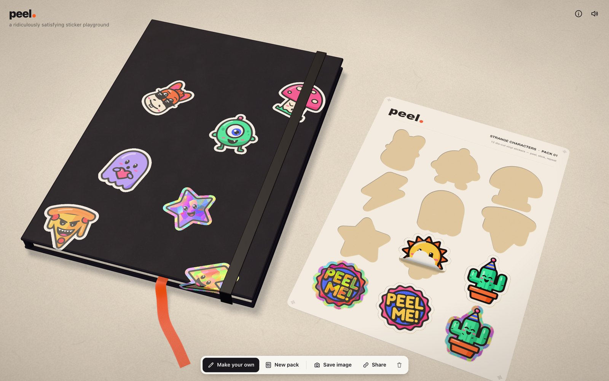
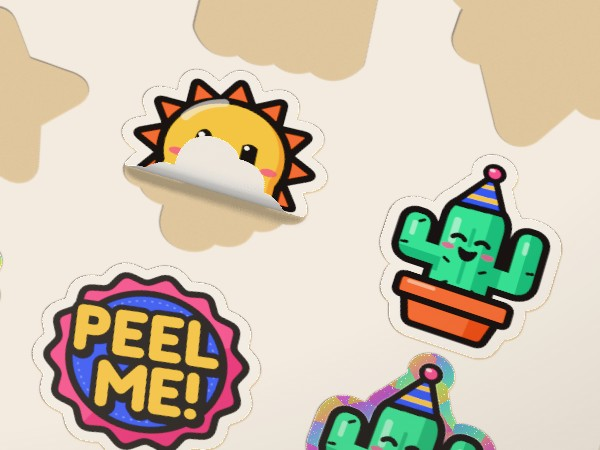

# arnas. — a sticker playground

**Live demo: [arn.as/sticker-mule](https://arn.as/sticker-mule/)** — works on desktop and phones.

A sticker playground in the browser. Open a pack, grab a corner, peel one off and slap it onto a notebook.



```sh
npm install
npm run dev     # http://localhost:4791
npm run check   # type-check, formatting, unit tests
npm run e2e     # browser smoke test: peel, carry, drop, make your own
npm run build   # static site in dist/
```

## What you can do

- **Peel.** Press near a sticker's edge and drag across it. The sticker curls back from that exact spot and the glossy liner shows underneath. Pull away from the sticker instead and it lifts until the tension pops it free. Grab it in the middle and it plucks straight off.
- **Stick.** Carry it anywhere. It swings on the point you're holding and leans into the direction you move. Scroll or press Q/E to spin it, then let go and it slaps down. Stickers stack. If one hangs off the notebook it wraps over the edge.
- **Holo.** Three of the characters are holographic. Move the mouse, drag the desk to tilt the view, or tilt your phone, and the foil shifts colour.
- **Make your own.** Draw one, or drop in an image (plain backgrounds are removed automatically). Pick gloss, matte or holo, and it gets a die-cut border and lands in your hand.
- **Keep it.** The notebook saves itself locally. _Share_ puts the whole composition, custom art included, into a link. _Save image_ downloads a PNG.

## How it works

### The peel model (`src/peel/model.ts`)

A sticker is treated as an inextensible sheet. A peel is fully described by a fold line (direction `d` and position `f`), a curl radius `r` and a wrap angle `θ`:

- points on the stuck side of the fold stay put;
- points past the fold wrap around a cylinder of radius `r` for up to `θ` radians;
- after that the sheet carries on as a straight flap.

Arc length is preserved, so the sticker never stretches (the tests check this numerically).

The harder part is the inverse problem: given where the pointer is, find the fold so that the point you grabbed lands under the cursor.

- **Folding back over the sticker** has an exact answer. The grabbed point travels `s − r·sin(s/r)` along the peel direction while it's on the curl, which is solved with guarded Newton iteration, and `(reach + πr)/2` once the flap lies flat on top.
- **Pulling away from the sticker** has no answer for an inextensible sheet. Instead the flap lifts and builds tension, and the sticker pops free when the tension passes a threshold. Real vinyl behaves the same way.

The pointer target is spring-smoothed and the fold direction is blended, so switching between the two cases never snaps. Releasing early sends the target back through an underdamped spring, so the flap slaps down.

Once a sticker is free, it's carried by the exact point you were holding (`pivot · tilt · yaw · translate(−grab)`, using the grab point's _curled_ position). That's why a freshly popped flap unfolds around your fingers instead of jumping.

### Wrapping over edges (`src/peel/wrap.ts`)

Stickers that hang past the notebook's edge fold over it, run down the side and continue onto the desk. Each point's distance from the edge is kept the same, so the sticker doesn't stretch here either.

### Hit testing and peel direction (`src/stickers/factory.ts`)

Each sticker's die-cut silhouette is rasterised to a coarse mask. A chamfer distance transform of that mask gives two things at any point:

- the distance to the edge, which decides whether you're peeling or plucking;
- the gradient, which points inward and so gives the natural peel direction.

The gradient sends a corner grab along the bisector and an edge grab straight in. Picking raycasts the deformed meshes, then checks the hit's UV against the mask, so the transparent part of the quad can't be grabbed.

### Rendering

- **Geometry.** A resting sticker is two static meshes cut from its silhouette: an opaque core and a thin alpha-tested edge band (`src/stickers/split.ts`). The GPU can skip whatever the opaque core covers, so a pile of overlapping stickers costs roughly one layer, not all of them. A sticker that's curling, wrapping or flying switches to an 84×84 grid that the CPU deforms only on frames where something changed. It shares that grid between its printed front and an adhesive-paper back face.
- **Soft shadows.** `src/scene/pcss.ts` patches three's shadow lookup with percentage-closer soft shadows. A blocker search estimates how high the occluder is and widens the filter to match. A lifted corner gets a tight contact shadow, and a sticker held 3 cm up throws a broad, faint one. Two things keep it cheap:
  - Blockers are compared by world height rather than raw depth. That's exact for an orthographic light, and it means a flat surface lit at an angle never shadows itself.
  - A small min/max summary of the shadow map is checked first, so most pixels answer with one texture fetch instead of a 24-tap search.
- **Holographic foil.** `src/stickers/materials.ts` injects a foil pass into the sticker material before lighting:
  - Voronoi "shattered glass" shards, each a tiny mirror at its own tilt;
  - a spectral tint driven mostly by the reflection vector, so colour follows the viewing angle;
  - a sheen band that slides across;
  - glitter that only flashes when a fleck lines up with your eye.

  Foil is masked per sticker, so the ink and faces stay printed.

- **Generated assets.** Textures, die-cut borders, the kiss-cut sheet (with liner holes and a roughness map for the glossy liner) and all sounds are generated at runtime. The peel crackle is a stream of band-passed noise grains whose density follows the speed of the peel front.

### Performance

Nothing is drawn unless something changed. The frame loop (`src/loop.ts`) goes to sleep entirely when the scene is still and wakes on input. The only thing that wakes it on its own is the "peel me" corner's occasional flutter on the opening screen, which stops once you've peeled something. Shadows are re-rendered only when something that casts one moves. Passive motion (parallax, settling springs) is capped at 60 fps, while dragging gets the display's full rate. Pixel ratio is capped at 1.5 and drops on slower GPUs.

Measured on an M4, 1920×1080 window at 1.5× (2880×1620 pixels):

| Scene                                         | GPU per frame |
| --------------------------------------------- | ------------- |
| Opening view                                  | ~2 ms         |
| 92 overlapping stickers                       | ~5 ms         |
| Idle (nothing moving, no flutter in progress) | no frames     |

### Layout

| File                                   | What it owns                                                    |
| -------------------------------------- | --------------------------------------------------------------- |
| `src/peel/model.ts`                    | peel geometry and the drag → fold solver (pure, tested)         |
| `src/peel/wrap.ts`                     | wrapping over box edges (pure, tested)                          |
| `src/playground.ts`                    | interaction state machine: hover, peel, carry, drop, layering   |
| `src/stickers/factory.ts`              | art → die-cut sticker, masks, distance field                    |
| `src/stickers/sticker.ts`              | per-sticker meshes, pose and deformation                        |
| `src/stickers/split.ts`                | resting sticker → opaque core + alpha-tested edge band          |
| `src/stickers/materials.ts`            | gloss / matte / holo materials, shared per design               |
| `src/stickers/art.ts`                  | the ten characters, as SVG                                      |
| `src/scene/*`                          | renderer, camera, desk, notebook, sheet, PCSS                   |
| `src/loop.ts`                          | frame loop that sleeps when idle                                |
| `src/view.ts`                          | camera: opening shot, desk tilt, pointer/gyro parallax          |
| `src/library.ts`                       | sticker designs (built-in and user-made), built once and cached |
| `src/composition.ts`, `src/persist.ts` | saving the desk, share links (tested)                           |
| `src/ui.ts`                            | toolbar, sticker maker, hints                                   |
| `src/audio.ts`                         | synthesised sound                                               |


